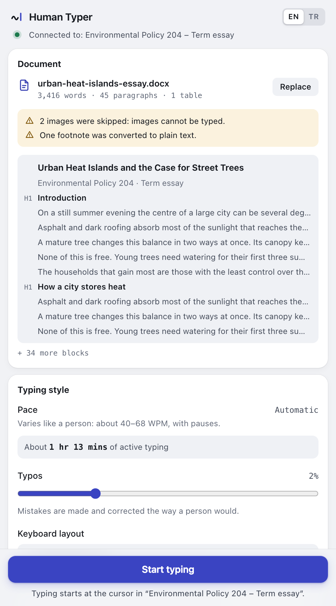
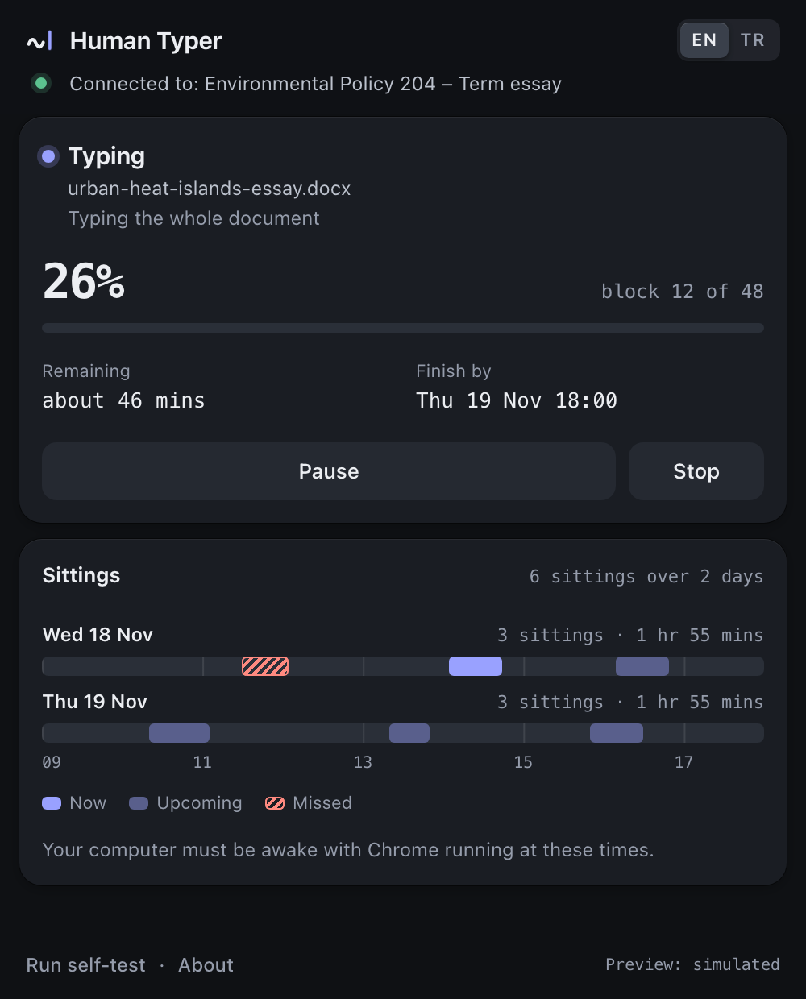
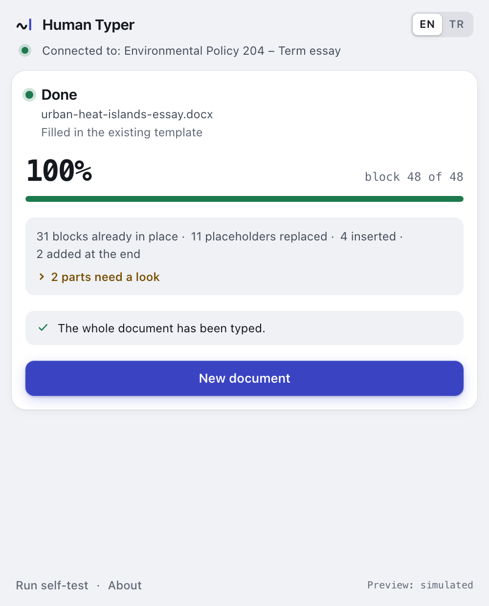
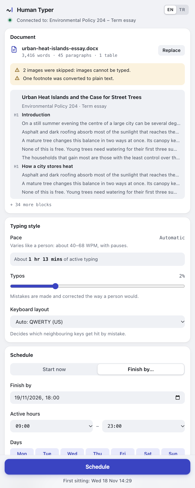
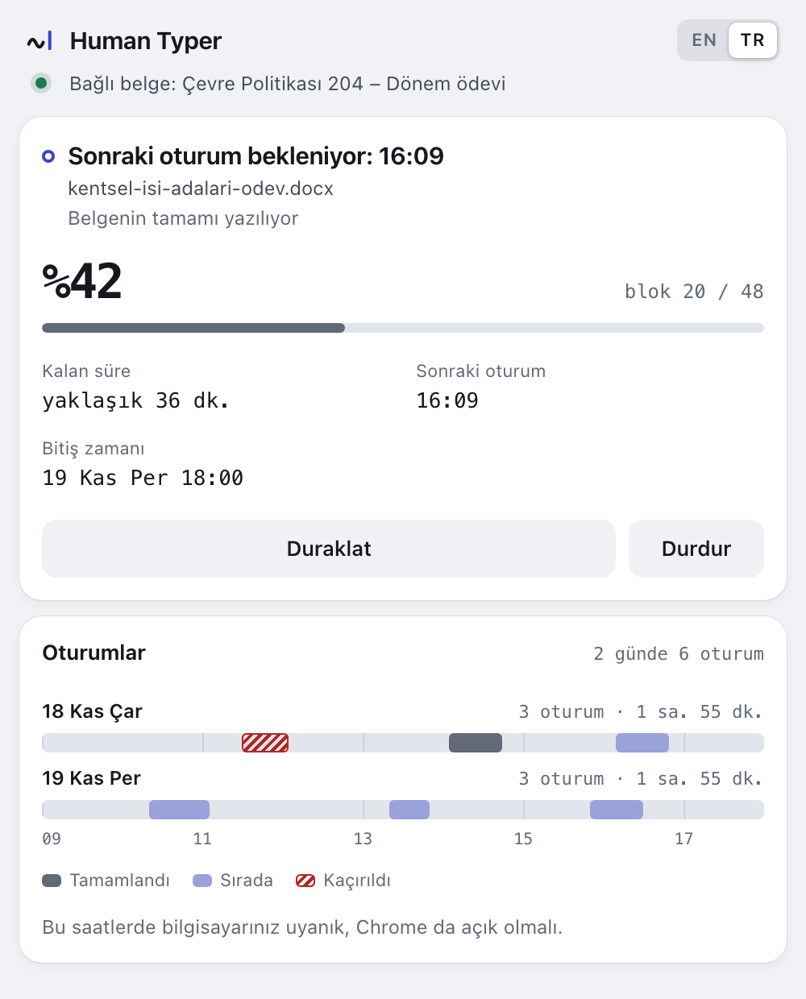

<p align="center">
  
</p>

<h1 align="center">Human Typer</h1>

<p align="center">
  A Chrome extension that types a document into Google Docs the way a person would:<br>
  uneven pace, small mistakes, corrections, pauses, and sittings spread over time.
</p>

<p align="center">
  <a href="LICENSE"></a>
  
  
  
</p>

<p align="center">
  
  
  
</p>

## What it does

Drop a `.docx`, `.md` or `.txt` file into the side panel, open a Google Doc, and press start. Human Typer types the document into the Doc keystroke by keystroke.

- **Formatted documents, not just text.** Headings, bold, italic, underline, strikethrough, bulleted and numbered lists with nesting, alignment, and tables.
- **Template fill.** If the Google Doc already contains an empty template (labels, headings, tables with blank cells), give it the filled-in version. It walks the existing document and types only what is missing; it does not rebuild your tables.
- **A pace nobody picked.** There is no speed setting. Each run draws its own base speed (about 40 to 68 words per minute) and lets it drift: faster inside familiar words, slower at word starts, capitals and punctuation, with pauses between phrases, sentences and paragraphs and the occasional longer rest.
- **Mistakes and corrections.** Wrong neighbouring key, dropped letter, extra letter. About half are fixed at once and the rest a few letters later, each with its own burst of backspaces. Works with Turkish Q and US QWERTY layouts, chosen automatically from the text.
- **Finish by a deadline.** Choose "Finish by…", the hours of the day you allow, and the days of the week. The work is split into irregular sittings before the deadline. If the computer was asleep for one of them, the rest is planned again.
- **Checks its own work.** When typing ends, the document is read back and compared with the source. Anything that does not match is fixed in one repair pass, and whatever is left is listed.
- **English and Turkish interface**, light and dark themes.

<p align="center">
  
  &nbsp;&nbsp;
  
</p>

## Install

Human Typer is not on the Chrome Web Store. Load it from source (Chrome 116 or newer):

1. Clone this repository.
2. Open `chrome://extensions` and turn on **Developer mode**.
3. Click **Load unpacked** and choose the `human-typer` folder.
4. Pin the extension and click its icon to open the side panel.

After pulling new changes, press the reload button on the extension card and reload any open Google Docs tabs.

## Use

1. Open the Google Doc you want to type into and click where typing should begin. For template fill, just open the template.
2. Open the side panel and drop your document in.
3. Adjust the typo rate and keyboard layout if you want to.
4. Choose **Start now** or **Finish by…**, then start.

To try it without a document of your own, use [`docs/samples/sample.docx`](docs/samples/sample.docx): a short Turkish text with a heading, inline styles, a bulleted and a numbered list, and a small table.

Keep the Google Docs tab visible while it types. Chrome slows timers in hidden tabs, so typing pauses when the tab is hidden and continues when you return. Scheduled sittings need the computer awake and Chrome running.

The **Run self-test** link at the bottom of the panel types a short probe at the cursor and reads it back, which tells you in a few seconds whether typing works on your Docs build.

## How it works

```
 file ──► parser ──► document model ──► planner ──► actions ──► executor ──► Google Docs
            lib/                        planner.js              content.js
                                        lib/fill.js             transport.js
                         scheduler (lib/scheduler.js) and job state: background.js
```

- **Parser** (`lib/`): a small ZIP reader and XML tokenizer turn `.docx` into a plain document model (paragraphs with runs, lists, tables). Markdown and plain text go to the same model.
- **Planner** (`planner.js`): a pure, seeded function from one block of the document to a list of timed actions: characters, backspaces, shortcut keys, table insertion. The timing model draws on published keystroke research (Dhakal et al. 2018 on 136 million keystrokes; Crump and Logan 2013 on error correction). Where no measurement exists, the parameter is marked as an assumption in the code.
- **Template fill** (`lib/fill.js`): aligns the live document with the filled version and produces "go to this paragraph, type this" units.
- **Scheduler** (`lib/scheduler.js`): places irregular sittings inside the allowed hours before a deadline.
- **Service worker** (`background.js`): owns the job and stores it, so it survives the worker being shut down. It hands the page one block at a time.
- **Executor** (`content.js`, `transport.js`): dispatches synthetic keyboard and paste events into the hidden input frame of the Docs editor. No `debugger` permission and no Google API access are used.

Everything is plain JavaScript with no build step and no dependencies.

## Limitations

- Google does not document the Docs editor internals this relies on. A Docs update can break typing until `transport.js` is adjusted; the self-test is the quick check.
- Images in a .docx (in the body and in table cells) are pasted in place, each in its own paragraph, after a long pause (as if the writer went to fetch the picture). Images in headers, footers and nested tables, linked images and formats Docs cannot show (EMF, WMF, TIFF) are skipped.
- Reference-list entries (paragraphs under a "References", "Bibliography" or "Kaynakça" heading, up to the next heading) are pasted whole instead of typed.
- Footnotes, comments and text boxes are skipped, with a warning when the file is loaded.
- Links are pasted one at a time as plain text rather than typed out.
- From a .docx, each paragraph keeps its spacing, line height, indents (including hanging), alignment, page breaks and the font, size, bold and italic of every run; tables keep their column widths and cell shading. Fonts missing from your Docs font menu (e.g. Calibri) are added to it first, because Docs drops pasted fonts it does not list. Tested on a real coursework file: 194 of 197 paragraphs came back identical.
- Docs' own autocorrect is sidestepped for straight quotes, "1." list starts and (c)/--/1/2 symbols. Its spelling autocorrect, which would "fix" a misspelling the source keeps (e.g. "grammer"), is switched off at the start of each job (Tools › Preferences › Automatically correct spelling). This is an account-wide Docs setting and stays off afterwards; tick it again there if you want it back.
- Landscape sections are not reproduced; a wide table is scaled down to the portrait page width.
- For .md/.txt input the font and size set in the panel are applied to normal paragraphs, lists and table cells; headings keep their Docs style.
- The main header and footer are typed after the body, then page numbers are added with Docs' own page-number tool (only the number: other text on that line, such as "Page … of …", is left out). A different first-page header/footer is skipped.
- Pace has three presets (slow ≈ 40, normal ≈ 60, fast ≈ 90 words per minute on average), each varied like a person.
- Docs has no keyboard shortcut for the Title and Subtitle styles. Title is typed as Heading 1 and Subtitle as normal text.
- In template fill, typed text takes on the formatting already at that spot in the template. Text cannot be deleted, and a filled table with a different shape from the template is only filled where the two overlap.
- Paragraph navigation shortcuts were verified on macOS. The Windows, Linux and ChromeOS mappings follow the Docs shortcut list and have had less testing.
- Docs' own autocorrect (smart quotes, automatic capitalisation, automatic lists) can change what was typed. The final check ignores quote and dash differences; turn the other substitutions off under Tools → Preferences if they interfere.
- If the tab is closed in the middle of a table, that job cannot resume by itself.

## Responsible use

Human Typer reproduces the mechanics of typing. It does not make text yours. Presenting a document's revision history as evidence of how it was written, when it was written some other way, is deceptive, and at a school or university it is likely to breach academic integrity rules. Use it for your own writing, demos, screen recordings and testing, and follow the rules that apply to you. The authors accept no responsibility for misuse.

## Development

```bash
cd human-typer && node --test
```

The suite covers the parsers, planner, template fill, scheduler, and the service worker's job state machine against a fake `chrome` API. Node 18 or newer is required.

To preview the panel without loading the extension, serve the folder and open it with a mock state:

```bash
cd human-typer && python3 -m http.server 8765
```

Then visit `http://localhost:8765/ui/sidepanel.html?state=running&lang=en`. States: `empty`, `notarget`, `loaded`, `deadline`, `infeasible`, `running`, `paused`, `waiting`, `done`, `error`, `stopped`, `fill`, `filldone`. Add `lang=tr` for the Turkish interface.

The `reports/` and `research_notes/` folders hold the background research behind the design (in Turkish).

## Contributing

Issues and pull requests are welcome. Keep modules dependency-free and pure where they can be, add tests alongside changes, and mark any timing parameter as measured (with a source) or assumed.

## License

[MIT](LICENSE)
